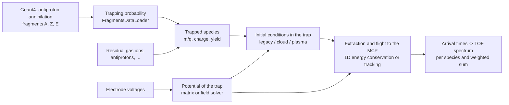

# Time-of-flight simulation of ions released from a Penning trap

This document has two parts:
- **Physics**: what the simulation calculates and the approximations it makes.
- **Usage**: how to run it, what it produces, and how to choose the parameters.

The code lives in `calculate_tof.py` (command line and signal processing) and in `modules/`.

---

# Part 1 – Physics

## 1.1 Overview

The simulation predicts the signal an MCP detector records when ions stored in a Penning trap are released by pulsing one wall of the trap.



1. **Fragments:** Geant4 simulates antiproton annihilations on a target nucleus and records the fragments produced.
2. **Trapping:** an analytic calculation gives the probability that each fragment is caught in the trap.
3. **Species list:** the result, possibly extended with other ions (residual gas, antiprotons), is a list of species. Each has a mass-to-charge ratio $m/q$, a charge state $q$ and a relative abundance (weight).
4. **Time of flight:** for each species, the simulation takes the potential of the trap before and after the pulse and a model of how the ions sit in the trap. It then calculates when each ion reaches the MCP.
5. **Spectrum:** the arrival times are histogrammed into a TOF spectrum.

There are two TOF engines:
- **`legacy` (default):** a fast 1D model that uses energy conservation on the trap axis.
- **`tracking`:** an axisymmetric (3D) field solver, physical initial conditions (thermal cloud or plasma), and particle tracking in the electric and magnetic fields.

## 1.2 Fragments and their trapping probability

`modules/FragmentsDataLoader.py`, function `create_lf_with_weights`.

Geant4 gives, for every annihilation event, the fragments (mass number $A$, charge $Z$) and their kinetic energies $E$. A fragment is assumed to be:
- **fully stripped:** charge $Z$;
- **emitted isotropically;**
- **created at radius $r_0$** in a trap with wall potential $V$, electrode radius $R$ and magnetic field $B$ along the axis.

Let $\theta$ be the angle between the momentum and the field. The fragment is trapped when:

- **axially**, its axial energy is below the depth of the trap:
  $$E\cos^2\theta \le ZeV;$$
- **radially**, its whole cyclotron orbit stays inside the electrodes. The orbit starts at $r_0$, so it reaches $r_0 + 2r_c$:
  $$r_0 + 2r_c \le R, \qquad r_c = \frac{p\sin\theta}{ZeB},\quad p=\sqrt{2mE}.$$

For isotropic emission $\cos\theta$ is uniformly distributed, so the trapped fraction of directions (both hemispheres) is
$$f_\text{trap} = \max\left(0,\ \cos\theta_1 - \cos\theta_2\right),\qquad
\cos\theta_1 = \min\!\left(1,\sqrt{\frac{ZeV}{E}}\right),\quad
\sin\theta_2 = \min\!\left(1,\frac{(R-r_0)\,ZeB}{2\sqrt{2mE}}\right).$$

Other details of the yield calculation:
- **Masses:** atomic masses are taken from the IAEA table. If a mass is missing, the code uses $A\cdot u$.
- **Lifetimes:** fragments with a half-life shorter than `half_life` decay before the measurement and are removed. Stable isotopes are treated as having infinite half-life.
- **Yield:** the trapped yield per annihilation is $Y = \frac{1}{N_\text{ev}}\sum f_\text{trap}$. The sum runs over the fragments of the first `max_events` events (default $10^6$), and $N_\text{ev}$ is the number of those events.
- **Units:** $E$ in keV, $V$ in kV, $R$ and $r_0$ in m, $B$ in T.

## 1.3 Electrostatic potential of the trap

### Electrode voltages

`calculate_tof._electrode_voltages`. The trap is the AEgIS 5 T electrode stack (`modules/trap.py`). The parameters name three groups of electrodes:
- the **floor**: default P10–P12, set to `--trap_floor_V`;
- the **right wall**: default P13, set to `--trap_wall_V`;
- the **left wall**: default P7–P9. It is used to locate the trap, but every electrode before the floor is set to the wall voltage.

Electrodes after the right wall are grounded, and C1 is always grounded. To launch the ions, the right wall is switched to `--pulse_wall_to_V` (default 0 V).

- **Coordinates:** $z=0$ is the middle of the floor and the ions fly towards $+z$.
- **Sign convention:** potentials are written for **positively charged** particles. For antiprotons, use the magnitudes of the (negative) voltages.

### Legacy: on-axis potential matrix

The legacy engine uses `ElectrodesPotentialMap.txt`. It holds the on-axis potential $M_k(z)$ created by each electrode $k$ at 1 V, on a 0.5 mm grid. The potential on the axis is the superposition
$$\phi(z) = \sum_k V_k M_k(z).$$

### Tracking: axisymmetric field solver

The tracking engine uses `modules/field_solver.py` and `modules/geometry.py`. For cylindrical electrodes the problem is exactly two-dimensional in $(r,z)$, so the solver computes the full 3D potential:
$$\frac{1}{r}\frac{\partial}{\partial r}\left(r\frac{\partial\phi}{\partial r}\right)+\frac{\partial^2\phi}{\partial z^2} = -\frac{\rho}{\varepsilon_0}.$$

**Boundary conditions:**
- **Electrode radius** ($r=R=15$ mm): $\phi$ equals the electrode voltages, with a linear change across the gaps.
- **Ends of the tube:** grounded, $4R$ beyond the stack.
- **Axis:** regular, $\partial\phi/\partial r = 0$.

**Discretisation and solution:**
- The equation is discretised with the five-point stencil on a uniform grid (default 0.25 mm). On the axis the radial term is $4(\phi_1-\phi_0)/\Delta r^2$.
- The linear system is solved directly. A discrete sine transform along $z$ diagonalises the second difference, then each $z$ mode is a tridiagonal system in $r$.
- One solve takes about 10 ms on the 61 × 4741 grid.

**Uses:**
- The same solver gives the potential of the space charge (Poisson's equation with all electrodes grounded).
- The electric field $\mathbf E = -\nabla\phi$ is interpolated bilinearly.

**Validation:**
- The solver reproduces analytic solutions: Bessel modes, and a uniformly charged cylinder with $\phi=\rho(R^2-r^2)/4\varepsilon_0$.
- It reproduces the on-axis matrix: to better than 0.1% for the C trap, and in shape for the P trap. The P-trap rows of the matrix are shifted by about 0.95 mm relative to the electrode positions in `TTrap`.

### The well

`plasma.find_well` locates the potential well on the axis:
- the **bottom** near $z=0$;
- the two **barriers** on either side of it.

The **depth** of the well is the lower barrier minus the bottom.

## 1.4 Initial conditions: how the ions sit in the trap

### Legacy model: space-charge limits

The legacy model is used by the legacy engine, and by the tracking engine with `--model legacy`.

**Space-charge limits:**
- **Full trap:** the part of the well between the left wall and the right barrier. $V_\text{min}$ is its bottom.
- **`spacecharge_min_V`:** the bottom is flattened at $V_\text{min}+$`spacecharge_min_V`. This mimics the potential of the ions' own space charge.
- **`spacecharge_max_V`:** the ions fill the well up to $V_\text{min}+$`spacecharge_max_V`. If it is not set, they fill the full depth.

**Sampling:**
- **Positions:** sampled from a generalised normal distribution $\propto\exp(-|(z-z_0)/s|^\beta)$ truncated to the filled region:
  - `thermalised`: flat top, $\beta=10$, $s=W/2.5$, where $W$ is the width of the filled region;
  - otherwise: Gaussian, $\beta=2$, $s=W/6$.
- **Energies:** the kinetic energy at launch is the space-charge offset plus an energy drawn uniformly up to the fill level.
- **Directions:** in the legacy engine every ion starts towards the detector. In the tracking engine half start backwards, unless `--forward_only True`.

### Thermal cloud (`--model cloud`)

This model is for non-interacting ions in thermal equilibrium. It applies when the Debye length is larger than the cloud. Along each field line (fixed radius) the density follows the Boltzmann distribution in the trap potential, and the radial profile is Gaussian:
$$n(r,z)\propto \exp\!\left(-\frac{r^2}{2\sigma_r^2}\right)\exp\!\left(-\frac{q[\phi(r,z)-\min_z\phi(r,z)]}{k_BT_\parallel}\right).$$

- **Axial velocities:** Maxwellian with $T_\parallel$ (`--temperature_K`).
- **Perpendicular velocities:** a 2D Maxwell distribution with $T_\perp$ (`--T_perp_K`, default $T_\parallel$). This sets the magnetic moment $\mu = mv_\perp^2/2B$.
- **Truncation:** ions whose axial energy $q\phi + \tfrac12 mv_z^2$ exceeds the barrier at their radius are not trapped, so they are resampled.

### Plasma (`--model plasma`)

This model is for a non-neutral plasma, where the Debye length is much smaller than the plasma. All species are in **global thermal equilibrium**: they share the temperature $T$ and the rotation frequency $\omega$ of the plasma.
$$n_s(r,z) = n_{s0}\exp\!\left\{-\frac{q_s\left[\phi_\text{ext}(r,z)+\phi_\text{sc}(r,z)\right] + \tfrac12 m_s\,\omega(\Omega_s-\omega)\,r^2}{k_BT}\right\},\qquad \Omega_s=\frac{q_sB}{m_s},$$
$$\nabla^2\phi_\text{sc} = -\frac{1}{\varepsilon_0}\sum_s q_s n_s .$$

The space-charge potential vanishes on the electrodes.

**Number of ions per species:**
- The plasma holds `--n_charges` elementary charges in total.
- They are shared according to the weights $w_s$: $N_s = n_\text{charges}\,w_s/\sum_k w_k q_k$.

**Solving the Poisson–Boltzmann equation:**
- **Domain:** a window ±30 mm around the well.
- **Newton's method:** the Jacobian is exact. It has a local Debye-shielding part and a rank-one normalisation part per species, handled with the Woodbury formula.
- **Line search:** each Newton step uses one.
- **Temperature annealing:** the temperature is lowered gradually from the depth of the well to $T$.
- **Rotation frequency:** $\omega$ is found by bisection so that the plasma radius $r_p=\sqrt{2\langle r^2\rangle}$ (the edge of a uniform column) equals `--plasma_radius_mm`.
- **Cold limit:** the density inside the plasma becomes uniform at the Brillouin value $n = 2\varepsilon_0 m\,\omega(\Omega-\omega)/q^2$. A test checks this.
- **Confinement check:** if the density at the edges of the well or at the electrodes isn't negligible, the plasma doesn't fit in the trap and the run stops with an error.

**Sampling:** ions are sampled from $n_s$ with Maxwellian velocities, as for the cloud.

**Which model?** The Debye length is
$$\lambda_D=\sqrt{\frac{\varepsilon_0 k_BT}{n q^2}}.$$
- If $\lambda_D$ is smaller than the size of the ion cloud, the plasma model is appropriate.
- If it is larger, the cloud model is appropriate.

For example, $10^6$ charges of He²⁺ in a 1 mm plasma ($n\approx10^{13}\,\text{m}^{-3}$) at $k_BT=0.1$ eV give $\lambda_D\approx0.3$ mm, which is a borderline case.

## 1.5 Extraction and flight to the MCP

### The pulse

At $t=0$ the potential changes from the trap (prepare) configuration to the launch configuration:
$$\phi(t)=\phi_\text{prep}+s(t)\left(\phi_\text{launch}-\phi_\text{prep}\right),\qquad s(t)=\min(1,\,t/\tau_\text{rise}).$$

The rise time $\tau_\text{rise}$ is set with `--pulse_rise_time_s`; with the default of 0 the switch is instantaneous. The legacy engine always assumes an instantaneous switch.

### Legacy engine: 1D energy conservation

`calculate_tof._calculate_velocities`, `_calculate_times`.
- **Energy:** an ion starting at $z_i$ with kinetic energy $K$ has total energy $\mathcal E = qV_\text{launch}(z_i)+K$ after the switch.
- **Speed:** on the axis its speed is $v(z)=\sqrt{2[\mathcal E-qV_\text{launch}(z)]/m}$.
- **Time per cell:** between grid points the force is assumed constant, so the time across a cell of length $\Delta z$ is exactly $2\Delta z/(v_a+v_b)$.
- **Drift:** after the last point of the potential the ion drifts to the MCP at its final speed.
- **Trapped ions:** ions that meet a barrier higher than their energy stay trapped and aren't counted.

### Tracking engine: guiding-centre motion

`modules/tracker.py`. In a 5 T field the cyclotron radius of a thermal ion is about 0.01–0.1 mm. The electric field varies on the scale $R/2.4\approx6$ mm. So each ion moves along a field line, with the guiding centre at radius $r_{gc}$, and only its motion along the field matters:
$$\frac{dz}{dt}=v_\parallel,\qquad m\frac{dv_\parallel}{dt}=qE_z(r_{gc},z,t)-\mu\frac{\partial B}{\partial z},\qquad \mu=\frac{mv_\perp^2}{2B}=\text{const},\qquad r_{gc}^2B=\text{const}.$$

- **Drifts:** the $E\times B$ and magnetron drifts are azimuthal, so they don't change the axial motion.
- **Integration:** leapfrog (kick–drift–kick) with time step `--dt_s` (default 1 ns). The arrival times change by less than 0.1 ns between 1 ns and 0.1 ns steps.
- **Validation:** a full 3D Boris pusher (`--tracker boris`, with the paraxial $B_r=-\tfrac r2\,\partial B_z/\partial z$) agrees with the guiding-centre result to better than 1 ns.

**Space charge during the extraction** (`--space_charge`):

| mode | meaning |
|---|---|
| `off` | No space charge (default for `legacy` and `cloud`). |
| `initial` | Space charge is used only for the plasma equilibrium at $t=0$; during the extraction the ions don't interact. |
| `dynamic` | Default for `plasma`. Every `--poisson_every` steps the charge of the ions is deposited on the grid (cloud-in-cell), the Poisson equation is solved, and the field of the space charge is added. This describes the Coulomb expansion of the bunch while it is inside the electrode stack. |

**Flight to the MCP:**
- Once an ion passes the end of the electric field (where $|\phi|$ drops below $10^{-6}$ of its maximum), it drifts to the MCP at `--distance_to_mcp_m`.
- In a uniform field the drift time is distance divided by $v_\parallel$.
- With a field profile (`--B_profile`, a csv file with columns `z_m,Bz_T`), energy and magnetic moment are conserved:
  $$v_\parallel^2(z)=v_{\parallel,\text{exit}}^2-\frac{2\mu}{m}\left[B(z)-B(z_\text{exit})\right],\qquad t=\int\frac{dz}{v_\parallel(z)} .$$
  When the field drops, perpendicular energy turns into parallel energy. When it rises enough, the ion is reflected (magnetic mirror).

**Fates of the ions:**
- **arrived;**
- **hit an electrode:** $r_{gc}+r_c\ge R$;
- **reflected:** by a magnetic mirror;
- **trapped:** still in the trap after `--t_max_s`, default the end of `--tof_range`.

Only arrived ions contribute to the spectrum.

## 1.6 From arrival times to a TOF spectrum

For each species the simulation runs `--iterations` independent samples of `--N_particles` ions. Let $c_{mk}$ be the number of ions of iteration $m$ arriving in bin $k$ (bin width `--tof_dt`). Then
$$\text{signal}_k=\frac{\langle c_{mk}\rangle_m}{N},\qquad \text{signal\_err}_k=\frac{\operatorname{std}_m(c_{mk})}{\sqrt{M}\,N}.$$

- **Normalisation:** the signal is the fraction of simulated ions of that species per bin, so it sums to the fraction that arrived.
- **Bin times:** each bin is labelled by its centre; empty bins aren't stored.
- **Total spectrum:** $\sum_s w_s\,\text{signal}_s(t)$, with errors added in quadrature.
- **Peak position:** a Gaussian $a\exp(-((t-t_0)/c)^2)$ is fitted to the bins above 60% of the maximum, giving `tof_peak_s` $=t_0$.
- **Detector response:** the MCP response (gain, detection efficiency against mass, charge and energy) isn't modelled. The signal is proportional to the number of ions.

## 1.7 Assumptions and limitations

- **Electrodes:** cylindrical, all with the same radius (15 mm), with a linear potential across the gaps. Positions come from `TTrap`.
- **Magnetic field:** uniform (`--B_T`) unless a profile is given.
- **Region in front of the MCP:** assumed field-free. The MCP bias and grids aren't modelled; `--distance_to_mcp_m` is an effective distance.
- **Charge and collisions:** charge states don't change, and there are no collisions, charge exchange or recombination during the extraction.
- **Space charge:**
  - In the plasma model it is self-consistent in the trap.
  - During the extraction it is followed only inside the electrode stack; there is no Coulomb expansion in the drift region.
  - The legacy models describe space charge only through the `spacecharge_*` limits.
- **Guiding-centre approximation:** no finite-Larmor-radius effects and no polarisation drift. The Boris pusher can check this when needed.
- **Fragment trapping:** the fragments are assumed fully stripped when they are created. In the TOF their charge state is the one given in the input.

## 1.8 Validation

- **Unit tests** (`python -m pytest`, 54 tests) check:
  - the trapping fraction against a Monte Carlo of isotropic directions;
  - the time integration against analytic solutions;
  - the histogram normalisation;
  - the field solver against analytic solutions and the potential matrix;
  - the cloud and plasma samplers, including the Debye/Brillouin limits;
  - guiding-centre against Boris tracking;
  - the magnetic mirror and the dynamic space charge.
- **Benchmarks against data** (`benchmarks/`; method and how to run them in `benchmarks/README.md`). Results from October 2026:
  - **Antiproton calibration** (18 floor voltages, wall −150 V):
    - The tracking engine reproduces the peak widths and arrival times with the launch at the pulse pickup and an effective distance of about 1.03 m.
    - The legacy engine needs 1–3 V of space-charge energy to match the widths. It then has to be shifted by about −440 ns relative to the pickup to match the timing.
  - **Ar40 runs 427300/427304/427316:**
    - The best description is the tracking engine with a hot cloud ($T\approx3\times10^4$ K): $\chi^2/\text{dof}=10.7$, against 27.6 for the best legacy setting.
    - For the best configurations, the effective flight distance from the peak positions is 1.01–1.04 m. The real distance of the temporary set-up is only known to be 1.0–1.2 m.

---

# Part 2 – Usage

## 2.1 Installation

```sh
conda create -n tof_simulation -c conda-forge python=3.12 --file requirements.txt
conda activate tof_simulation
python -m pytest          # optional: run the tests
```

On lxplus, see the README section "Setup on lxplus". Only polars has to be installed in addition to LCG_108.

## 2.2 Command line

```
python calculate_tof.py [common options] <command> [command options]
```

- **Order of arguments:** common options go **before** the command.
- **Booleans** (`--thermalised`, `--savefig`, `--showfig`, `--forward_only`): `True/False` (or `1/0`).
- **Masks:** hexadecimal (`0x13`).
- **`--`:** everything after `--` is ignored.

| command | what it simulates | command options |
|---|---|---|
| `tof` | one species | `--mq` (u/e, required), `--label`, `--weight`, `--charge` (default 1) |
| `tof_pbar` | antiprotons ($m/q$ = 1.007276 u/e) | `--weight` |
| `tof_fragments` | all species of a yields file (see 2.5) | `--fragments_data_path` (required) |
| `tof_calibration` | antiproton scan of the floor voltage (wall 150 V: floors 30–130 V; wall 190 V: floors 155–175 V), fit of $V_\text{floor}$ against $m/(2qt^2)$ | – |

Defaults that depend on the command:
- **`tof_pbar`:** plot mask 0x1f and prefix `pbar` when none are given.
- **`tof_fragments`:** plot mask 0x11 and prefix `Ar40` when none are given.

### Examples

He²⁺ with the legacy engine, the well filled from 0.5 V above the bottom:
```sh
python calculate_tof.py --trap_floor_V 180 --trap_wall_V 190 --spacecharge_min_V 0.5 --plot_mask 0x1f tof --mq 2.0013 --label He2+
```

The same with the tracking engine and a hot thermal cloud (plots: potentials and initial conditions, fitted peak, total signal):
```sh
python calculate_tof.py --trap_floor_V 180 --trap_wall_V 190 --engine tracking --model cloud --temperature_K 30000 --plot_mask 0x38 tof --mq 2.0013 --charge 2 --label He2+
```

A plasma of $10^6$ charges with a radius of 1 mm at 1000 K, with dynamic space charge (the default for the plasma):
```sh
python calculate_tof.py --trap_floor_V 180 --trap_wall_V 190 --engine tracking --model plasma --n_charges 1e6 --plasma_radius_mm 1 --temperature_K 1000 --plot_mask 0x30 tof --mq 2.0013 --charge 2
```

Antiprotons (calibration configuration, magnitudes of the voltages):
```sh
python calculate_tof.py --trap_floor_V 110 --trap_wall_V 150 --engine tracking --model cloud --temperature_K 10000 tof_pbar
```

All fragments, saving the spectra and PNG plots without showing them:
```sh
python calculate_tof.py --trap_floor_V 180 --trap_wall_V 190 --engine tracking --model cloud --temperature_K 30000 --savedata_mask 0x01 --savefig True --showfig False --fig_format png tof_fragments --fragments_data_path Ar40_trappable.parquet
```

## 2.3 Options

### Trap and detector (both engines)

| option | default | meaning |
|---|---|---|
| `--trap_floor_V` | required | voltage of the floor electrodes |
| `--trap_wall_V` | required | voltage of the walls (all electrodes before the floor and the right wall) |
| `--pulse_wall_to_V` | 0 | voltage of the right wall after the pulse |
| `--trap_left_wall` | P7 P8 P9 | left wall (start of the trap region) |
| `--trap_floor` | P10 P11 P12 | floor; $z=0$ is its middle |
| `--trap_right_wall` | P13 | pulsed right wall |
| `--distance_to_mcp_m` | 1.05 | distance from the middle of the floor to the MCP (effective, see 1.8) |

### Statistics, binning and output (both engines)

| option | default | meaning |
|---|---|---|
| `--N_particles` | 10000 | ions per species and iteration |
| `--iterations` | 10 | independent iterations (used for the uncertainties) |
| `--tof_range` | 0 1e-4 | time range of the spectrum [s] |
| `--tof_dt` | 1e-9 | bin width [s] |
| `--verbose_level` | 0 | 0 silent, 1 peak table, 2 more (trapped fraction, signals), 3 everything |
| `--plot_mask`, `--savedata_mask` | 0 | see 2.4 |
| `--savefig`, `--showfig` | False, True | save figures to `plots/` and show them |
| `--fig_format`, `--dpi` | eps, 200 | figure format and on-screen resolution (saved figures use 600 dpi) |
| `--file_prefix` | – | prefix of the output file names |

### Legacy initial conditions (`--engine legacy`, or `--engine tracking --model legacy`)

| option | default | meaning |
|---|---|---|
| `--spacecharge_min_V` | None | flattened bottom of the well, above its minimum [V] |
| `--spacecharge_max_V` | None | fill level of the well, above its minimum [V] (None: full depth) |
| `--thermalised` | True | flat-top (True) or Gaussian (False) distribution in $z$ |
| `--forward_only` | False | tracking only: all ions start towards the MCP, as in the legacy engine |

### Tracking engine (`--engine tracking`)

| option | default | meaning |
|---|---|---|
| `--model` | cloud | `legacy`, `cloud` or `plasma` initial conditions (1.4) |
| `--temperature_K` | 300 | temperature (parallel temperature if `--T_perp_K` is set) |
| `--T_perp_K` | = T | perpendicular temperature |
| `--cloud_radius_mm` | 1.0 | σ of the radial profile of the cloud |
| `--plasma_radius_mm` | 1.0 | plasma radius $\sqrt{2\langle r^2\rangle}$ |
| `--n_charges` | 1e5 | total number of elementary charges, shared by the species according to their weights |
| `--space_charge` | dynamic for plasma, off otherwise | `off`, `initial`, `dynamic` (1.5) |
| `--poisson_every` | 5 | time steps between updates of the space-charge field |
| `--B_T` | 5.0 | uniform magnetic field [T] |
| `--B_profile` | – | csv with `z_m` (relative to the middle of the floor) and `Bz_T`; replaces `--B_T` |
| `--pulse_rise_time_s` | 0 | linear rise time of the pulse |
| `--dt_s` | 1e-9 | time step of the tracking |
| `--t_max_s` | end of `--tof_range` | ions still in the trap at this time count as trapped |
| `--grid_mm` | 0.25 | grid spacing of the field solver |
| `--electrode_radius_mm` | 15 | inner radius of the electrodes |
| `--tracker` | gc | `gc` (guiding centre) or `boris` (full 3D; slow, for validation) |
| `--seed` | random | seed of the random numbers (reproducible results) |

## 2.4 Outputs

Files are written next to `calculate_tof.py`, in `data/` (parquet) and `plots/`. The names follow `<file_prefix>_<title>_<parameters>.<ext>`. In the legacy engine the parameters part describes voltages, space-charge limits, bin width and statistics. In the tracking engine it starts with `tracking_<model>`.

| bit | `--plot_mask` | `--savedata_mask` |
|---|---|---|
| 0x01 | potential and trap regions (legacy) | `tof_signal` and `tof_peak` |
| 0x02 | initial conditions (legacy) | potential (legacy: full table; tracking: on-axis `V_prepare`, `V_launch`, `V_space_charge`) |
| 0x04 | velocities and times against the initial position (legacy) | legacy: velocities on the grid (large); tracking: initial conditions |
| 0x08 | spectrum and fitted peak of each species | arrival time of every ion |
| 0x10 | total spectrum (weighted sum of the species) | – |
| 0x20 | tracking: potentials, density and phase space of the initial ions | – |

Combine the bits, e.g. `--plot_mask 0x13` for the potential, the initial conditions and the total spectrum.

**Columns of the saved tables:**

| table | columns |
|---|---|
| `tof_signal` | `t [s]` (bin centre), `signal` (fraction of the ions of the species per bin), `signal_err`, `label`, `m/q`, `weight` |
| `tof_peak` | `label`, `m/q`, `tof_peak_s`, `tof_peak_err_s` (NaN when the Gaussian fit fails) |
| `times` (tracking) | `iteration`, `particle`, `species`, `label`, `z_i [mm]`, `t [s]` (NaN if not arrived), `status` (0 arrived, 1 trapped, 2 hit an electrode, 3 reflected) |

To compare with an MCP trace, sum `signal * weight` over the species at each `t [s]`. Rebin with the bin width of the data, keeping the bin centres.

## 2.5 Preparing the fragments input

`tof_fragments` reads a parquet file with the columns:
- `m_over_q` (u/e);
- `label`;
- `trappable_count` (the weight, e.g. yield per annihilation);
- optionally `charge` or `fragmentZ`.

The tracking engine needs the charge state for the thermal velocities and the space charge; without it, it assumes charge 1 and prints a warning. To create the file for fully stripped Ar40 fragments trapped in a 12 kV catching trap:

```python
import sys
sys.path.append("modules")
import polars as pl
import FragmentsDataLoader as loader   # data folder: FRAGMENTS_DATA_PATH environment variable

yields = (loader.create_lf_with_weights("Ar40", half_life=600, V=12, R=0.015, B=5, r0=0.0)
          .group_by("fragmentZ", "fragmentN")
          .agg(pl.col("atomic_mass").first(),
               (pl.col("trappable_fraction").sum() / pl.col("total_events").first()).alias("trappable_count"))
          .collect()
          .with_columns(m_over_q=pl.col("atomic_mass") / pl.col("fragmentZ"),
                        label=pl.format("{}-{}", pl.col("fragmentZ") + pl.col("fragmentN"), pl.col("fragmentZ")))
          .filter(pl.col("trappable_count") > 0))
yields.write_parquet("Ar40_trappable.parquet")
```

Other ions, such as residual gas, can be appended as extra rows with their own `m_over_q`, `charge` and weight.

## 2.6 Python interface

`calculate_tof` takes the command-line parameters as keyword arguments and returns the spectra and the fitted peaks:

```python
import polars as pl
import calculate_tof as ct   # from the repository root; the module adds modules/ to the path

signal, peak = ct.calculate_tof(mq=[2.0013, 4.0026], labels=["He2+", "He+"], weights=[0.1, 1.0], charges=[2, 1],
                                trap_floor_V=180, trap_wall_V=190,
                                engine="tracking", model="cloud", temperature_K=30000,
                                N_particles=10000, iterations=5, seed=1, showfig=False)
total = signal.group_by("t [s]").agg((pl.col("signal") * pl.col("weight")).sum()).sort("t [s]")
```

For per-ion results, use `tof_tracking.simulate_tracking`. It returns the arrival time and status of every ion, the initial conditions, and the fields and well (`output.setup`).

The building blocks can also be used separately:
- `field_solver.AxisymmetricSolver(geometry).laplace({electrode: voltage})` gives the potential on the $(r,z)$ grid;
- `plasma.PoissonBoltzmannSolver` gives plasma equilibria;
- `tracker.GuidingCenterTracker` tracks ions in given fields.

The legacy engine uses NumPy's global random generator, so call `numpy.random.seed(...)` before `calculate_tof` for reproducible legacy results. The tracking engine uses `seed`.

## 2.7 Choosing the model and the parameters

**Engine:**
- Use `tracking` for physics results.
- `legacy` is fast and reproduces the older analysis. Its results changed when the time integration and averaging were fixed, so old outputs aren't directly comparable.

**Model:**
- `cloud` for few ions ($\lambda_D$ larger than the cloud).
- `plasma` for dense ion plasmas. If the requested plasma doesn't fit in the well, the run stops with an error: reduce `--n_charges`, increase the radius, or deepen the well.

**Temperature:** the benchmarks prefer hot ions:
- about $10^4$ K for antiprotons;
- about $3\times10^4$ K for the Ar40 ions.

Expect the temperature to be a fitted parameter.

**Flight distance:**
- `--distance_to_mcp_m` is an effective distance. Calibrate it with the antiproton runs (`benchmarks/pbar_calibration.py`); the benchmarks gave 1.01–1.04 m for the tracking engine.
- Otherwise fit it together with a time offset.

**Statistics:** the spectrum uncertainty scales as $1/\sqrt{N\cdot\text{iterations}}$. Typical run times per iteration of 25 000 ions per species:

| configuration | time per iteration |
|---|---|
| cloud, 1 species | ~1 s |
| cloud, 10 species | ~30 s |
| plasma with dynamic space charge, 1 species | ~12 s |
| plasma with dynamic space charge, 10 species | ~70 s |

The tracking engine needs much less memory than the legacy engine. The legacy engine builds a table of (ions × grid points).

**Numerics:**
- The defaults (`--dt_s 1e-9`, `--grid_mm 0.25`) are converged to better than 0.1 ns.
- Use a smaller `--dt_s` for very light, fast ions.
- `--tracker boris` chooses its own time step to resolve the cyclotron motion.

**Bins:** use `--tof_dt` of 1–10 ns. Compare with data by rebinning to the resolution of the data.

## 2.8 Running on HTCondor (lxplus)

`condor_scripts/SimulateTof.sh` passes its arguments to `calculate_tof.py`. The `.sub` files define the scans, e.g. over `spacecharge_min`.

- **Tracking engine:** add `--engine tracking --model ...` to the `arguments` line of a submit file.
- **Dependencies:** no extra ones; NumPy and SciPy come from LCG.
- **Plasma jobs:** a plasma with dynamic space charge takes minutes per iteration, so request enough job time.

## 2.9 Tests and benchmarks

```sh
python -m pytest                                    # unit tests
python benchmarks/pbar_calibration.py --workers 8   # antiproton calibration runs
python benchmarks/ar40_runs.py --workers 8          # Ar40 runs
python benchmarks/plot_ar40_first_peak.py           # fit of the first Ar40 peak (He2+ and fragments)
```

The benchmarks cache every simulation in `benchmarks/output/cache` and resume after an interruption. `benchmarks/verify_cache.py` recomputes a sample of the cache to detect results corrupted by hardware faults.
